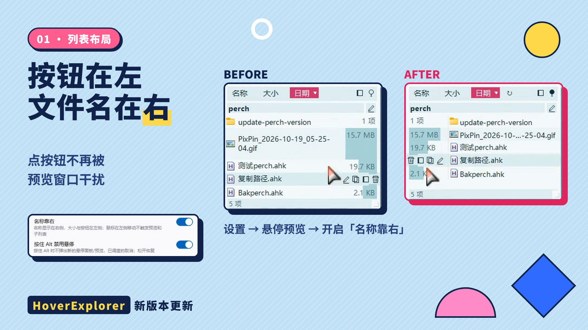

# HoverExplorer


鼠标悬停即可浏览文件夹内容与预览文件，无需点击打开。

> Hover to browse folder contents and preview files — no clicks needed.

## 界面预览

**文件列表面板** —— 悬停桌面/资源管理器文件夹即时弹出；触发区域可自定义，半透明色块实时预览



**收藏·历史列表** —— 桌面触发区或 `Ctrl+Shift+E` 热键呼出，行首星标一键收藏/取消


**桌面卡片** —— 文件钉成桌面浮动卡片，卡片上滚轮切换 11 套配色（逐张独立记忆）


**音频波形播放器** —— Media Foundation 后台解码整段文件生成峰值/RMS 波形，波形即进度，点击/拖动跳转


## 功能

- **桌面悬停**：鼠标悬停桌面文件夹 → 弹出文件列表，悬停文件 → 直接预览
- **资源管理器悬停**：同样支持在资源管理器中悬停浏览（可选开启），详细信息视图与图标视图均可；详细视图下默认仅在图标/文件名区域触发，名称右侧空白不再误触发
- **文件预览**：图片、文本、代码、压缩包(zip/7z/rar)、Office 文档、字体、exe、epub、音频/视频(播放)、SVG(图形+源码) 等
- **音频波形播放器**：悬停音频弹出迷你播放条，波形即进度——Media Foundation 后台静默解码整段文件生成峰值/RMS 波形（零新增依赖，解码失败自动退回实时采集包络）；点击/横向拖动波形 seek，竖向拖动移动窗口；悬停展开文件名/时间/格式信息区，固定后保持展开，点击信息区收起
- **收藏·历史列表**：桌面自定义触发区域（半透明色块实时预览）或全局热键快速弹出常用文件夹；行首星标一键收藏/取消并自动移入收藏分区；行悬停显示操作按钮（重命名/复制路径/固定为桌面卡片）；列表宽度可拖拽调整并记忆；配色跟随文件列表调色板；鼠标离开快速收起（≤200ms）
- **关闭延迟可调**：设置面板新增「关闭延迟」（50–2000ms），统一控制列表、预览窗、收藏·历史在鼠标离开后的关闭速度
- **设置即改即生效**：设置面板无确定/取消按钮，快捷键、延时、排序、开关等任何改动实时保存生效；快捷键改动立即重注册
- **快捷键切换**：全局快捷键一键启用/禁用悬停功能（默认 `Ctrl+Alt+Q`，可自定义）
- **悬停延时可调**：设置面板中自定义悬停触发延时，对文件夹和文件预览统一生效
- **深浅主题**：深色/浅色两套配色（滚动条、进度条同步深色）
- **卡片配色（逐张独立）**：内置 11 套标签带方案（墨黑/纸白/石墨单色/荧光绿终端/琥珀 CRT/糖果硬边/海军蓝金/樱粉/敦煌青绿/赛博霓虹/高对比黑白黄）；鼠标在某张卡片上滚轮即只切换该卡片配色，同时弹出配色列表并实时高亮当前项，停滚约 1 秒自动消失，也可直接点列表某行选定；每张卡片的配色随位置一起持久化
- **拖拽弹簧式文件夹**：拖着文件悬停任意文件夹（桌面 / 资源管理器 / 列表行 / 桌面卡片徽标）即弹其内容面板，子文件夹可逐层悬停展开导航，松手放入对应层；拖文件进入触发区域立即弹出收藏·历史列表接收拖放；拖拽中滚轮照常滚动指针下的列表
- **暂停触控区**：独立框选一块屏幕区域（设置中框选/清除，框选时实时显示尺寸，桌面色块绿=启用/红=暂停），鼠标驻留 0.3 秒切换悬停启用/暂停，与快捷键等效；最小可设 5×5 像素
- **MP3 秒开秒停**：真 MP3 走 MCI 毫秒级打开（切换即时），VBR 文件按 Xing 头精确帧数校正时长（MCI 会把 VBR 时长估长数倍）；自动识别"假 MP3"（视频站工具下载的 DASH/MP4 容器改了扩展名）并加载超时保护（6 秒显示失败，不再永远转圈）、切走即静音无拖尾
- **MP3 修复工具**：附带 `Mp3Fixer.exe`（中英双语），拖入文件/文件夹批量把容器型假 MP3 转成真 MP3（原地替换，真 MP3 自动跳过）；ffmpeg 自动搜索常见位置，找不到一键联网下载官方构建
- **面板高度自适应**：条目多时面板自动长高（以工作区为限）；手动拖过尺寸后转纯记忆模式
- **7 语言**：中文、English、日本語、한국어、Français、Русский、Español
- **关闭系统提示**：可选隐藏 Windows 原生 tooltip
- **开机自启**：可选写入注册表 Run 键，免安装
- **隐藏托盘图标**：隐藏后可在列表面板空白处右键呼出选项菜单
- **固定文件卡片**：预览窗点图钉按钮将文件固定为桌面浮动卡片，点 ▶ 按钮执行；中键关闭，右键弹 Windows 原生菜单；位置持久化，重启恢复
- **文件列表右键菜单**：打开、编辑、新窗口、重命名、删除、复制路径/名称、原生菜单（Windows shell 完整菜单）
- **预览窗复制菜单**：悬停复制按钮弹出复制选中文本/全文、复制文件、复制路径；鼠标移开按钮或菜单自动收起
- **按钮提示**：列表/预览窗的按钮悬停显示功能说明，显示在鼠标指针上方（不遮挡内容），可在托盘菜单「按钮提示」关闭
- **预览尺寸记忆**：图片/视频预览窗可拖右下角手柄或 `Ctrl+滚轮` 缩放，尺寸自动记住，下次预览沿用；原图/视频大尺寸自动限制在屏幕 80% 以内
- **音视频尺寸分开记忆**：视频与音频各自记住窗口尺寸；视频按真实宽高比自动调整窗口，不再固定 4:3 黑边
- **列表顶部显示文件夹名**：点击名称或 ✎ 图标就地重命名（超长名称自动多行编辑）；双击名称/排序栏空白处用资源管理器打开该文件夹；`Ctrl+F` 才展开搜索框，默认不显示输入框
- **行号与翻页键**：悬停某行时图标位显示淡色等宽行号（Courier New，随操作按钮同现同隐）；指针压在面板上时按 PageUp/PageDown 直接翻页（键盘焦点无需在面板）
- **文本预览编码保留**：预览中编辑文本保存时按原文件 BOM 写回（UTF-8/UTF-16/UTF-32），不会把 UTF-8(BOM) 写成无 BOM 导致 AHK 等程序按系统内码读出乱码
- **悬停触发更精准**：指针必须移动才触发，切换资源管理器标签页/目录不再误弹面板；正在重命名或地址栏输入时完全不弹
- **输入法友好**：输入框持有焦点时暂停强制置顶，中文输入法候选窗不再被面板/预览窗遮挡

## 使用

直接运行 `HoverExplorer.exe`，程序驻留系统托盘。

右键托盘图标（或列表面板空白处）可：
- 切换语言 / 主题
- 开关资源管理器悬停 / 文件预览 / 按钮提示 / 调试日志 / 系统提示 / 开机自启 / 隐藏托盘图标
- **设置** → 自定义快捷键、悬停触发延时、关闭延迟（改动即生效）
- 退出

面板/预览窗口：拖动标题栏可移动位置（移动后自动固定）；点固定按钮固定；右下角拖拽手柄调整尺寸（列表面板的手柄在鼠标移入面板后才显示，避免遮挡行信息）。移动窗口不会改变记住的尺寸，只有拖手柄/边缘调整才算。

改名：列表面板顶部点文件夹名或 ✎ 图标即可就地重命名（`Enter` 提交 / `Esc` 取消 / 点击别处提交）。

搜索：点击面板激活后按 `Ctrl+F` 展开搜索框（默认隐藏，避免抢焦点、遮挡输入法候选窗）。

设置面板底部提供 GitHub Releases 与百度网盘下载链接。

## 快捷键

默认 `Ctrl+Alt+Q`，功能为**切换悬停启用/禁用**。

在托盘「设置」面板中可：
- 勾选/取消「启用快捷键」
- 自由组合修饰键（Ctrl / Alt / Shift）
- 点击按键框后按下任意键设置主键
- 调整悬停触发延时（0.1–3 秒）

快捷键配置保存在 `config.json`，重启后生效。

## 编译

```powershell
# 使用 .NET Framework 4.x csc.exe 编译
$csc = "C:\Windows\Microsoft.NET\Framework64\v4.0.30319\csc.exe"
# 需引用 UIAutomationClient / UIAutomationTypes / WindowsBase / PresentationCore / System.IO.Compression.FileSystem
# 输出 HoverExplorer.exe
```

## 文件说明

| 文件 | 说明 |
|------|------|
| `Program.cs` | 主循环、托盘菜单、快捷键、tooltip 隐藏 |
| `PopupForm.cs` | 悬停弹出面板、文件预览窗体 |
| `PreviewProvider.cs` | 各类文件预览渲染 |
| `ExplorerSupport.cs` | 资源管理器 UIA 悬停检测 |
| `ExplorerUia.cs` | 名称区判定：表头查找、文字矩形/宽度估算 |
| `RemoteReader.cs` | 桌面 ListView 远程读取 |
| `NativeMethods.cs` | Win32 API P/Invoke |
| `Win11.cs` | DWM 毛玻璃/圆角/暗色标题区 |
| `SettingsForm.cs` | 设置面板（快捷键、延时、关闭延迟、排序等，即改即生效） |
| `MediaPreview.cs` | 音视频播放、音频波形/环回频谱采集、SVG 预览、自绘进度条 |
| `WaveDecoder.cs` | 音频全量波形：MF SourceReader 静默解码 + 峰值/RMS 摘要 |
| `EntryListForm.cs` | 收藏·历史列表（触发区域指示、星标收藏、宽度记忆） |
| `PanelPalette.cs` | 面板/预览窗语义配色（由卡片标签带配色派生） |
| `SlimScrollBar.cs` | 设置面板自绘细滚动条 |
| `MciAudioSession.cs` / `IMediaSession.cs` | MP3 的 MCI 毫秒级播放会话与统一播放接口 |
| `Mp3Fixer.cs`（→ Mp3Fixer.exe） | 假 MP3 检测/批量转码独立工具（拖拽即用，ffmpeg 自动探测/下载） |
| `Config.cs` | 配置持久化 + 主题配色 |
| `I18n.cs` | 7 语言国际化 |
| `PinCardForm.cs` | 固定文件桌面浮动卡片 |
| `CardPalette.cs` | 桌面卡片标签带配色方案（11 套） |
| `PaletteListForm.cs` | 滚轮切换配色时的实时配色速查列表 |
| `ShellContextMenu.cs` | Windows 原生 shell 右键菜单 |
| `build.ps1` | 一键编译脚本（自动解析 GAC 引用） |
